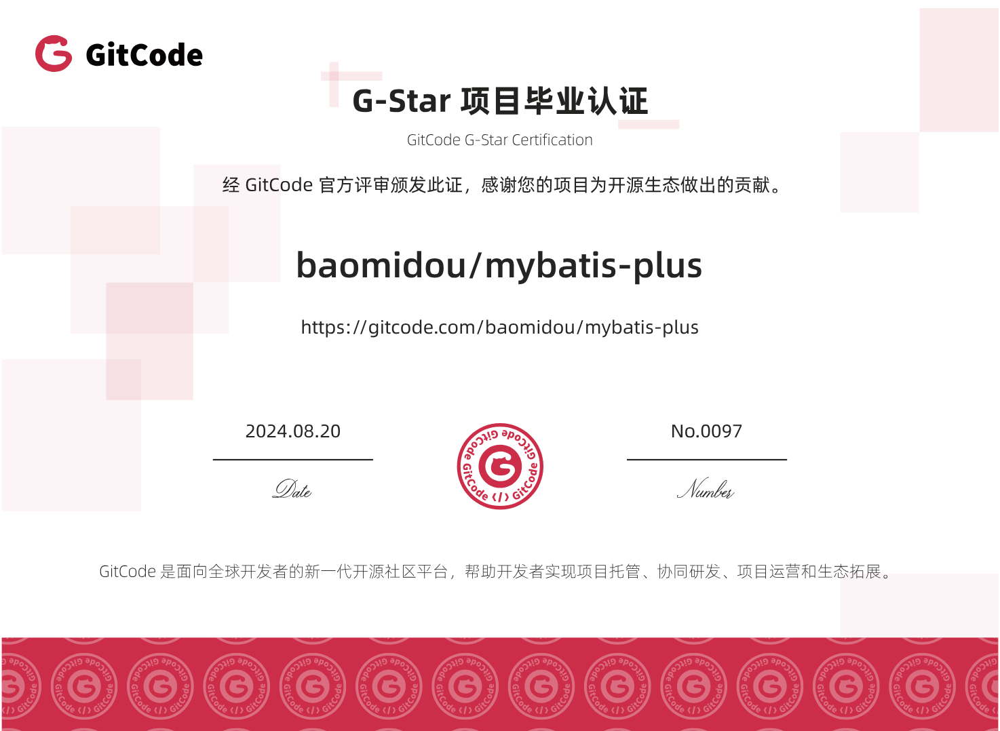

<p align="center">
  <a href="https://github.com/baomidou/mybatis-plus" target="_blank">
   
  </a>
</p>

<p align="center">
  为简化开发工作、提高生产率而生
</p>

<p align="center">

  <a href="https://github.com/baomidou/mybatis-plus">
    
  </a>

  <a href="https://gitee.com/baomidou/mybatis-plus">
    
  </a>

  <a href="https://gitcode.com/baomidou/mybatis-plus">
    
  </a>

  <a href="https://search.maven.org/search?q=g:com.baomidou%20a:mybatis-*">
    
  </a>

  <a href="https://www.apache.org/licenses/LICENSE-2.0">
    
  </a>
</p>

[企业版 Mybatis-Mate 高级特性](https://gitee.com/baomidou/mybatis-mate-examples)

# 简介 | Intro

Mybatis 增强工具包 - 只做增强不做改变，简化`CRUD`操作

添加 `微信 wx153666` 备注进 mp 群

> 不允许非法项目使用，后果自负

# 特别用户

<p>
  <a href="https://doc.flowlong.com?from=mp" target="_blank">
   
  </a>
  <a href="https://gitee.com/gz-yami/mall4j?from=mp" target="_blank">
   
  </a>
  <a href="http://github.crmeb.net/u/MyBatis-Plus" target="_blank">
   
  </a>
</p>

# 依赖引用

Latest Version: [](https://search.maven.org/search?q=g:com.baomidou%20a:mybatis-*)

根据项目使用的 Spring Boot 版本选择对应的 Starter，将 `Latest Version` 替换为所需的 MyBatis-Plus 版本。

## Spring Boot 4

需要 MyBatis-Plus 3.5.13 及以上版本。

Maven:

```xml
<dependency>
    <groupId>com.baomidou</groupId>
    <artifactId>mybatis-plus-spring-boot4-starter</artifactId>
    <version>Latest Version</version>
</dependency>
```

Gradle:

```groovy
implementation 'com.baomidou:mybatis-plus-spring-boot4-starter:Latest Version'
```

**测试依赖（按需引入）**

使用 `@MybatisPlusTest` 编写测试时，引入对应的测试 Starter，版本与上述 Starter 保持一致。

Maven:

```xml
<dependency>
    <groupId>com.baomidou</groupId>
    <artifactId>mybatis-plus-spring-boot4-starter-test</artifactId>
    <version>Latest Version</version>
    <scope>test</scope>
</dependency>
```

Gradle:

```groovy
testImplementation 'com.baomidou:mybatis-plus-spring-boot4-starter-test:Latest Version'
```

## Spring Boot 3

Maven:

```xml
<dependency>
    <groupId>com.baomidou</groupId>
    <artifactId>mybatis-plus-spring-boot3-starter</artifactId>
    <version>Latest Version</version>
</dependency>
```

Gradle:

```groovy
implementation 'com.baomidou:mybatis-plus-spring-boot3-starter:Latest Version'
```

**测试依赖（按需引入）**

使用 `@MybatisPlusTest` 编写测试时，引入对应的测试 Starter，版本与上述 Starter 保持一致。

Maven:

```xml
<dependency>
    <groupId>com.baomidou</groupId>
    <artifactId>mybatis-plus-spring-boot3-starter-test</artifactId>
    <version>Latest Version</version>
    <scope>test</scope>
</dependency>
```

Gradle:

```groovy
testImplementation 'com.baomidou:mybatis-plus-spring-boot3-starter-test:Latest Version'
```

## Spring Boot 2

Maven:

```xml
<dependency>
    <groupId>com.baomidou</groupId>
    <artifactId>mybatis-plus-boot-starter</artifactId>
    <version>Latest Version</version>
</dependency>
```

Gradle:

```groovy
implementation 'com.baomidou:mybatis-plus-boot-starter:Latest Version'
```

**测试依赖（按需引入）**

使用 `@MybatisPlusTest` 编写测试时，引入对应的测试 Starter，版本与上述 Starter 保持一致。

Maven:

```xml
<dependency>
    <groupId>com.baomidou</groupId>
    <artifactId>mybatis-plus-boot-starter-test</artifactId>
    <version>Latest Version</version>
    <scope>test</scope>
</dependency>
```

Gradle:

```groovy
testImplementation 'com.baomidou:mybatis-plus-boot-starter-test:Latest Version'
```

## SQL 解析依赖（按需引入）

从 MyBatis-Plus 3.5.9 开始，使用分页等依赖 SQL 解析的插件时，需要额外引入以下解析模块之一。请选择一个与 JDK 及所需 JSqlParser 版本匹配的模块，并与 Starter 保持相同的 MyBatis-Plus 版本。

下表中的 JSqlParser 版本以当前仓库的依赖配置为准；使用其他 MyBatis-Plus 版本时，请以对应发布版本的依赖为准。

| MyBatis-Plus 模块 | JSqlParser 版本 | JDK 要求 |
| --- | --- | --- |
| `mybatis-plus-jsqlparser` | 5.4 | JDK 11+ |
| `mybatis-plus-jsqlparser-5.2` | 5.2 | JDK 11+ |
| `mybatis-plus-jsqlparser-5.0` | 5.0 | JDK 11+ |
| `mybatis-plus-jsqlparser-4.9` | 4.9 | JDK 8+ |

以下以 `mybatis-plus-jsqlparser` 为例；使用其他 JSqlParser 版本时，将模块名替换为上表中的对应模块即可。

Maven:

```xml
<dependency>
    <groupId>com.baomidou</groupId>
    <artifactId>mybatis-plus-jsqlparser</artifactId>
    <version>Latest Version</version>
</dependency>
```

Gradle:

```groovy
implementation 'com.baomidou:mybatis-plus-jsqlparser:Latest Version'
```

# 优点 | Advantages

- **无侵入**：Mybatis-Plus 在 Mybatis 的基础上进行扩展，只做增强不做改变，引入 Mybatis-Plus 不会对您现有的 Mybatis
  构架产生任何影响，而且 MP 支持所有 Mybatis 原生的特性
- **依赖少**：仅仅依赖 Mybatis 以及 Mybatis-Spring
- **损耗小**：启动即会自动注入基本CURD，性能基本无损耗，直接面向对象操作
- **通用CRUD操作**：内置通用 Mapper、通用 Service，仅仅通过少量配置即可实现单表大部分 CRUD 操作，更有强大的条件构造器，满足各类使用需求
- **多种主键策略**：支持多达4种主键策略（内含分布式唯一ID生成器），可自由配置，完美解决主键问题
- **支持ActiveRecord**：支持 ActiveRecord 形式调用，实体类只需继承 Model 类即可实现基本 CRUD 操作
- **支持代码生成**：采用代码或者 Maven 插件可快速生成 Mapper 、 Model 、 Service 、 Controller
  层代码，支持模板引擎，更有超多自定义配置等您来使用（P.S. 比 Mybatis 官方的 Generator 更加强大！）
- **支持自定义全局通用操作**：支持全局通用方法注入( Write once, use anywhere )
- **内置分页插件**：基于Mybatis物理分页，开发者无需关心具体操作，配置好插件之后，写分页等同于写基本List查询
- **内置性能分析插件**：可输出Sql语句以及其执行时间，建议开发测试时启用该功能，能有效解决慢查询
- **内置全局拦截插件**：提供全表 delete 、 update 操作智能分析阻断，预防误操作

## 相关链接 | Links

- [文档](https://baomidou.com)
- [代码生成](https://github.com/baomidou/generator)
- [功能示例](https://github.com/baomidou/mybatis-plus-samples)
- [展示](https://github.com/baomidou/awesome-mybatis-plus)
- [企业版 Mybatis-Mate 高级特性](https://github.com/baomidou/mybatis-mate-examples)


# 其他开源项目 | Other Project

- [基于Cookie的SSO中间件 Kisso](https://gitee.com/baomidou/kisso)
- [Java快速开发框架 SpringWind](https://gitee.com/juapk/SpringWind)
- [基于Hibernate扩展 Hibernate-Plus](https://gitee.com/baomidou/hibernate-plus)
- [基于 pac4j-jwt 的快速集成的 web 安全组件 shaun](https://gitee.com/baomidou/shaun)

# 王者荣耀



# 期望 | Futures

> 欢迎提出更好的意见，帮助完善 Mybatis-Plus

# 版权 | License

[Apache License 2.0](https://www.apache.org/licenses/LICENSE-2.0)


# 关注我 | About Me
* Github: https://github.com/baomidou/mybatis-plus
* Gitee: https://gitee.com/baomidou/mybatis-plus
* GitCode: https://gitcode.com/baomidou/mybatis-plus

